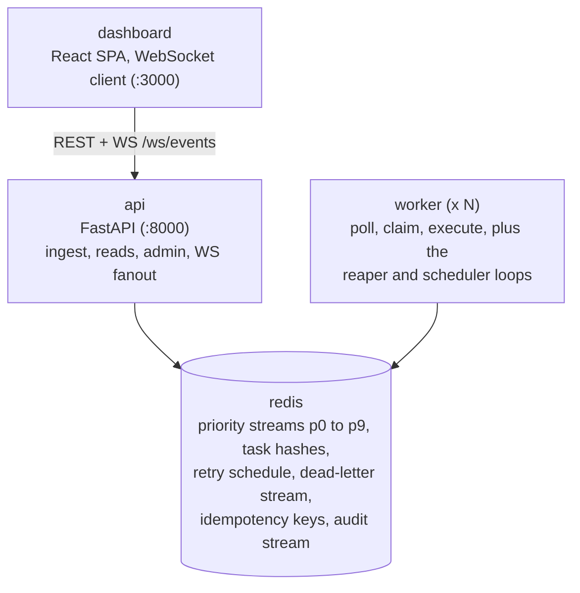

<div align="center">

# dtq

**A distributed task queue on Redis Streams, with the operational parts actually built.**

[](LICENSE)


</div>

dtq takes JSON tasks over HTTP, runs them on a pool of workers, and keeps
retrying them until they succeed or fail for good and land in the
dead-letter stream, where you can inspect and requeue them. Priorities,
retries with
backoff, idempotent submission, delayed tasks, backpressure, Prometheus
metrics, a live dashboard. One `docker compose up` and all of it is running.

I built it on Redis Streams rather than a list-based queue because streams
already solve the hard parts: consumer groups, pending entries, and claiming
work from a dead consumer. The engine is the code around that: claim
atomically, execute, record the outcome, and only then acknowledge.

## Try it

```
docker compose up --build
```

That starts Redis, the API, a worker, the dashboard, and Prometheus.

- API: http://localhost:8000 (routes under `/api/v1`, plus `/health`, `/ready`, `/metrics`)
- Dashboard: http://localhost:3000
- Prometheus: http://localhost:9090

Submit something:

```
curl -s -X POST localhost:8000/api/v1/tasks \
  -H 'Content-Type: application/json' \
  -d '{"task_type":"echo_task","payload":{"hello":"world"},"priority":9}'
curl -s localhost:8000/api/v1/tasks/<task_id>
```

More workers when you want them: `docker compose up --build --scale worker=3`.

No Docker? There is a local path too:

```
python3 -m venv .venv && .venv/bin/pip install -e .
redis-server --daemonize yes --save '' --appendonly no   # dev only, no persistence
.venv/bin/uvicorn --factory dtq_api.main:create_app --port 8000 &
.venv/bin/dtq worker run --concurrency 4
```

And `scripts/demo.sh` walks six end-to-end scenarios (a plain batch of
successes, retries, the DLQ, backpressure, a worker dying mid-task,
idempotent submits) against a scratch Redis DB if you want to see the
moving parts without reading code first.

## How it fits together



The life of a task is short to describe. `POST /api/v1/tasks` validates the
request, writes the task hash, and XADDs to one of ten priority streams (or
parks the task in the retry schedule if it has a delay). Workers read through
a shared consumer group with bounded prefetch, flip the task from QUEUED to
RUNNING with a Lua script so two workers cannot claim the same entry, run the
handler under a timeout, record the result, publish a lifecycle event, and
only then XACK. A worker that dies mid-task leaves its entries pending, and
`XAUTOCLAIM` hands them to a live worker. One worker holds the scheduler
leader lock and moves due retries back into the streams.

## What you get

- **Strict priorities.** Ten bands per queue, p9 down to p0. A p9 task never
  waits behind a p0 backlog.
- **Retries that know when to stop.** Exponential backoff with jitter and a
  capped delay. Errors are classified per attempt: retryable ones retry,
  everything else fails fast to the DLQ instead of burning attempts.
- **Idempotent ingest.** Send an `Idempotency-Key` header and replays return
  the stored task. A duplicate that arrives while the first is still in
  flight gets a 409, not a second execution.
- **A dead-letter stream you can work with.** Bounded and inspectable, with
  requeue (attempts reset, history kept), discard, and purge. Admin actions
  land in an audit stream.
- **Backpressure instead of collapse.** A queue-depth admission gate returns
  429 with `Retry-After`, payloads are size-capped (413), and worker prefetch
  and WebSocket buffers are bounded.
- **Observability.** Prometheus metrics, separate `/health` and `/ready`
  probes, structured JSON logs, and a WebSocket event stream for the
  dashboard.
- **Delayed and cancellable tasks.** `delay_seconds` parks a task until it is
  due. Cancellation is cooperative for both queued and running tasks.

## Writing a handler

A handler is a function with a decorator. Workers only ever run registered
handlers, never anything named by a request payload.

```python
from dtq_worker.registry import TaskContext, task

@task("echo_task")
def echo_task(payload, ctx: TaskContext):
    return {"echo": payload, "attempt": ctx.attempt}
```

Point `DTQ_TASK_MODULES` at your module so the worker imports it at startup,
and the task type is live. `examples/tasks` has a handful to copy from,
including a flaky one and an always-failing one for watching retries and the
DLQ do their thing.

The CLI covers the day-to-day: `dtq get`, `dtq list`, `dtq cancel`,
`dtq dlq list`, `dtq retry-dlq`, `dtq queue pause <q>`, `dtq queue stats <q>`.
Set `DTQ_API_KEY` and the destructive commands require an `X-API-Key` header.

## Numbers, with the context attached

Measured on 2026-10-01 on a 2 vCPU VM with 7 GB of RAM, against a local
Redis 8.10.2 with persistence off, running the no-op `echo_task`: the ingest
path took about 1,135 submissions a second. A single task with an idle
worker went from submit to succeeded in about 106 ms, which is the floor for
a claim round-trip, a handler call, an outcome write, an event publish, and
an ACK on this machine. Under a 2,000 task burst the completion rate was
about 262 tasks a second, so most of the latency there was queueing delay,
not execution cost. The full method, the raw results, and what actually
limits throughput are in [docs/performance.md](docs/performance.md), and
`scripts/load_test.py` reruns the whole thing.

The test suite is 169 tests across unit, integration, and end-to-end; run
`pytest` and count them yourself.

## Delivery semantics, stated plainly

dtq guarantees **at-least-once** execution. A task is never silently dropped
while its data exists in Redis, but a handler can run more than once: if a
worker crashes after the side effects and before the completion write, the
task is redelivered and the side effects happen again. Duplicate tasks are
absorbed by the claim-time checks; duplicate executions are part of the
model, so write handlers to be idempotent (`dtq_tasks.idempotent_operation`
helps). Also, do not treat the WebSocket stream as a record of anything. It
is Redis pub/sub, fire-and-forget, and a disconnected client misses events
with no replay.

## Docs

- [docs/architecture.md](docs/architecture.md): the components, how a
  task flows between them, and where the state lives.
- [docs/task-lifecycle.md](docs/task-lifecycle.md): the statuses a task
  moves through and which transitions are allowed.
- [docs/redis-streams.md](docs/redis-streams.md): the key layout, all of
  it under the `dtq:` prefix.
- [docs/retries.md](docs/retries.md): the retry policy, the backoff
  formula, and how errors get classified.
- [docs/idempotency.md](docs/idempotency.md): submission idempotency and
  handler-level dedup, and where each one stops helping.
- [docs/backpressure.md](docs/backpressure.md): the admission gate, the
  429 semantics, and every buffer that is bounded.
- [docs/delivery-guarantees.md](docs/delivery-guarantees.md): what
  at-least-once does and does not promise.
- [docs/worker-coordination.md](docs/worker-coordination.md): the four
  worker loops (poll, reaper, scheduler, heartbeat), claiming, and the
  scheduler leader lock.
- [docs/performance.md](docs/performance.md): measured throughput and
  latency, the method behind them, and what limits them.
- [docs/observability.md](docs/observability.md): metrics, probes, logging,
  the WebSocket stream, and the audit trail.
- [docs/failure-modes.md](docs/failure-modes.md): crash and restart
  scenarios, data-loss windows, and the operator recovery checklist.
- [docs/security.md](docs/security.md): trust boundaries, API-key auth,
  validation limits, and what is not protected.
- [docs/threat-model.md](docs/threat-model.md): assets, actors, attack
  surface, and residual risks.
- [docs/deployment.md](docs/deployment.md): compose topology, scaling, the
  full `DTQ_` environment reference, backup and restore.
- [docs/contributing.md](docs/contributing.md): repo layout, dev setup,
  tests, and commit conventions.
- [CONTRACT.md](CONTRACT.md): the normative spec, sections 1 to 15. Where
  the code and the contract disagree, the docs describe the code and say so.

## License

Apache License 2.0. See [LICENSE](LICENSE).
